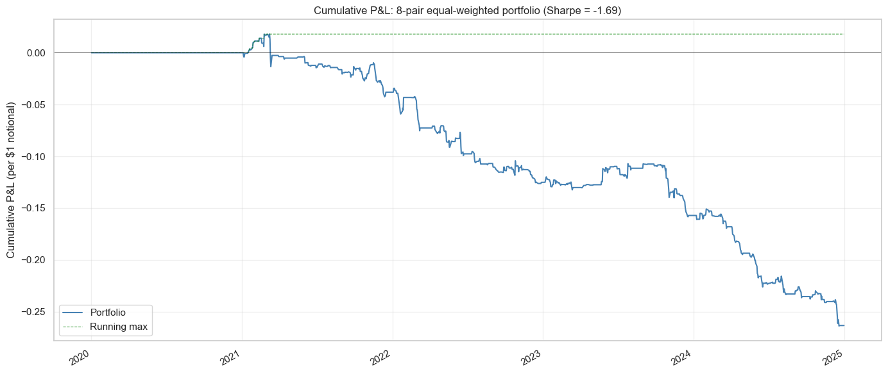

# Pairs-trading study

Screen equity pairs for cointegration, estimate changing hedge ratios and backtest a mean-reversion strategy with transaction costs.

**Net annualized Sharpe: −1.688082 at 10 bps per leg per side. The strategy did not work after costs.** It also lost before costs.



## Quick start

Run the offline tests from the repository root:

```bash
python3 -m venv .venv
.venv/bin/pip install -r requirements-dev.txt
.venv/bin/python -m pytest -q
```

For the study, execute notebooks `01` through `04` in order with Jupyter/nbconvert. The first notebook downloads adjusted Yahoo Finance prices for 2020–2024 through `src/pairs/data.py`; later notebooks use locally generated artifacts. No market sample is redistributed because provider redistribution permission has not been established.

## Method

- Fixed US large-cap stock universe; Engle–Granger cointegration screening.
- Bonferroni and Benjamini–Hochberg multiple-testing helpers.
- Kalman state-space regression on log prices; maximum-likelihood noise estimates.
- Spread entries at two standard deviations after a 252-day burn-in; exit on zero crossing.
- Entry hedge ratio held through each trade; costs charged on both legs at entry and exit.
- Equal-weighted normalized pair P&Ls aggregated into a portfolio.

## Results

The [saved notebook 04](notebooks/04_backtest.ipynb) contains these sensitivity-table values for eight candidate pairs. Model fitting and the backtest were not rerun during cleanup.

| Cost per leg per side | Annualized Sharpe | Cumulative normalized P&L |
|---|---:|---:|
| Zero | −0.412950 | −0.068332 |
| 10 bps | −1.688082 | −0.263332 |

Normalized P&L is not a fully specified investor capital return.

## What didn't work

Cointegration and changing hedge ratios did not establish a tradable edge. Full-sample pair screening and noise estimation prevent a clean out-of-sample interpretation. The surviving-stock universe, same-close fills and fixed costs omit selection, borrowing and execution effects. Parameter choices need a separate evaluation period.

## Tests, structure and licence

[](https://github.com/VChahar1/pairs-trading/actions/workflows/tests.yml)

Sixteen pytest tests pass. `src/pairs/` contains data, screening, Kalman and backtest functions; `tests/` checks those modules; `notebooks/` contains the ordered study. `scripts/export_chart.py` extracts the saved figure without executing notebook cells. Code: [MIT](LICENSE).
